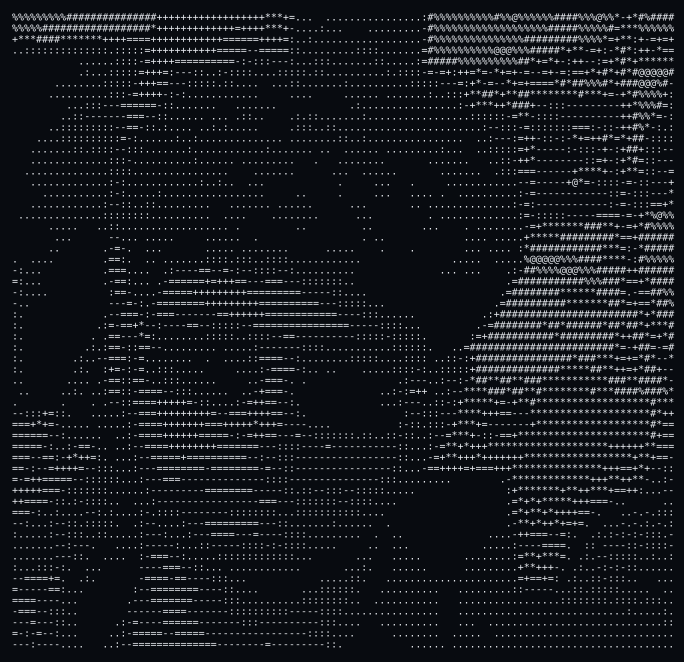
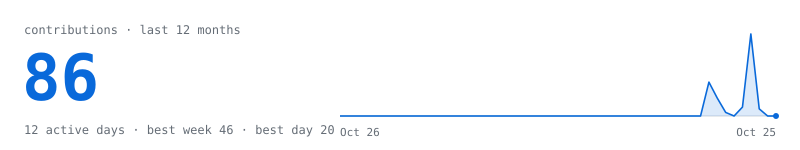
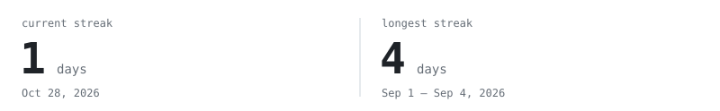
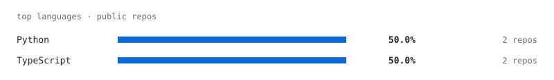
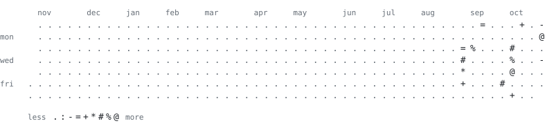

<picture><source media="(prefers-color-scheme: dark)" srcset="assets/hd-hello-dark.svg"></picture>

<picture><source media="(prefers-color-scheme: dark)" srcset="assets/moses-face-ascii-v6.svg"></picture>

> **Moses Andrew Raymond**, Andy to most people. Third-year CSE student in Chennai, 
> learning to break things properly so they can be fixed properly.

I work on both sides of security: penetration testing, vulnerability 
assessment, network security, and Python tooling that takes the boring 
parts off my plate. I've done two cybersecurity internships, I've been 
taking on freelance security and content work since 2024, and right now 
I'm studying for CompTIA Security+.

I like understanding a system well enough to know exactly where it gives.

 

<picture><source media="(prefers-color-scheme: dark)" srcset="assets/hd-stack-dark.svg"></picture>

<samp>Burp Suite · Metasploit · Nmap · Wireshark</samp> 
<samp>Kali Linux · OWASP Top 10 · Python</samp>

<picture><source media="(prefers-color-scheme: dark)" srcset="assets/hd-projects-dark.svg"></picture>

**BlackBox** 
<samp>my final-year project: autonomous cyber governance, containment, deception and recovery</samp>

**UV Store** 
<samp>a custom storefront for a menswear label, built to replace Shopify</samp>

More at [rootbyraymond.site.je](https://rootbyraymond.site.je).

<picture><source media="(prefers-color-scheme: dark)" srcset="assets/hd-activity-dark.svg"></picture>

<picture><source media="(prefers-color-scheme: dark)" srcset="gen/stats-dark.svg"></picture>
<picture><source media="(prefers-color-scheme: dark)" srcset="gen/streak-dark.svg"></picture>
<picture><source media="(prefers-color-scheme: dark)" srcset="gen/langs-dark.svg"></picture>
<picture><source media="(prefers-color-scheme: dark)" srcset="gen/year-dark.svg"></picture>

drawn by this repo every night. No third-party widgets involved.

<picture><source media="(prefers-color-scheme: dark)" srcset="assets/hd-contact-dark.svg"></picture>

[LinkedIn](https://in.linkedin.com/in/moses-andrew-raymond-4a7164339) · [Portfolio](https://rootbyraymond.site.je) · [GitHub](https://github.com/Andrew190707)
